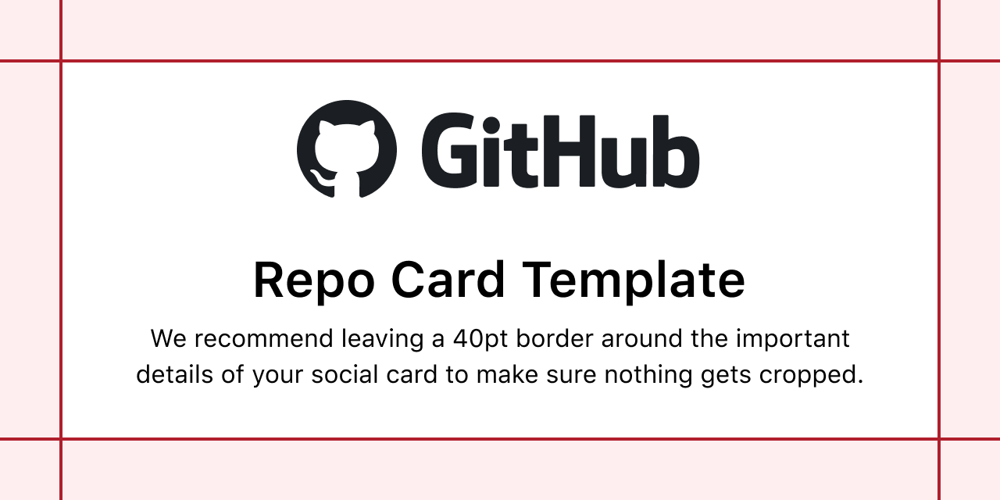

  

# FreeCodeCamp Python Projects

This repository contains Python exercises, practical labs, and projects completed during my FreeCodeCamp Python learning journey.

The goal is to document my progress, strengthen my problem-solving skills, and apply Python concepts through practical coding exercises.

## Repository Structure

### Python
Contains exercises, labs, and projects covering different Python concepts, including:

- Variables and Data Types
- Conditional Statements
- Loops
- Functions
- Lists, Tuples, and Dictionaries
- String Manipulation
- Error Handling
- Classes and Objects

## Technologies

- Python
- Git
- GitHub

## About

This repository serves as a record of my practical learning and development as I continue improving my Python programming skills.
